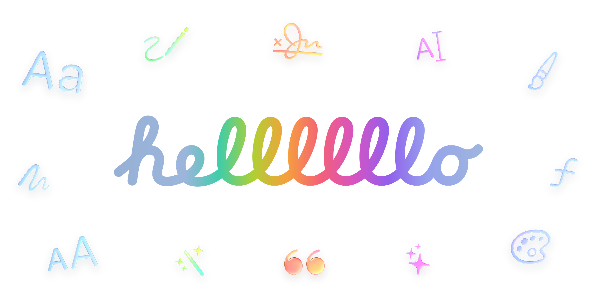
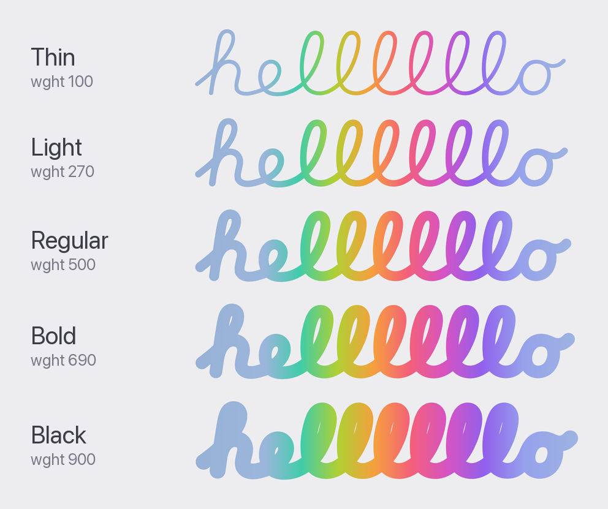
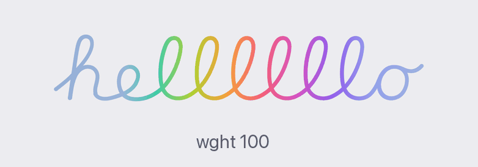
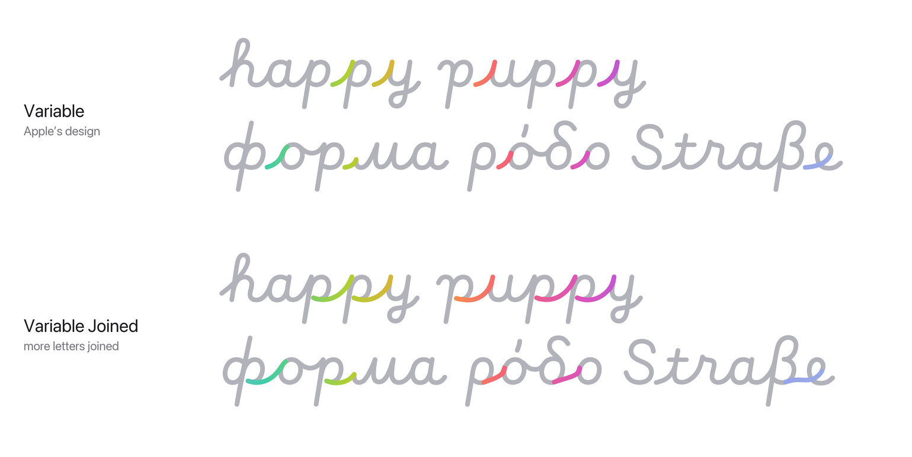
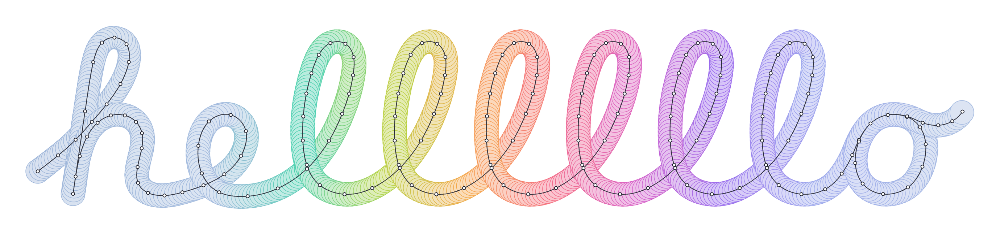

# Macintosh Skeletal Filled

The famoussss handwriting from Apple's **"hello"** screen, as fonts you can type with.

macOS 27 and iOS 27 ship a font called **Macintosh Skeletal** for the
personalized hello you see when setting up a new Mac or iPhone. On its own it
only contains the centre line of each stroke. Apple's renderer thickens those
strokes into tubes and joins the letters live. This project rebuilds what that
renderer draws as ordinary filled fonts, with joins that follow Apple's
renderer.

## Fonts

| File | Family | Weights |
|---|---|---|
| `fonts/MacintoshSkeletalVariable.otf` | Macintosh Skeletal Variable | Variable, `wght` 100 to 900 |
| `fonts/MacintoshSkeletalFilled.otf` | Macintosh Skeletal Filled | Static, Apple's on-screen weight |
| `fonts/MacintoshSkeletalVariableJoined.otf` | Macintosh Skeletal Variable Joined | Variable, with more letters joined ([see below](#joined)) |

### Variable weight

Weight is the pen thickness. Apple's renderer draws the font's strokes at
**1.55×** their stored radius, so that is the default (**Regular**).

| Style | `wght` | Pen thickness |
|---|---|---|
| Thin | 100 | 0.6× |
| Light | 270 | 1.0× (the raw font data) |
| **Regular** | **500** | **1.55× (Apple's hello screen)** |
| Bold | 690 | 2.0× |
| Black | 900 | 2.5× |

Any value in between works. Thickness is linear in `wght`, so every app shows
the same result.

### Static or variable?

- **Static (Macintosh Skeletal Filled):** strokes are merged into one clean
  outline per glyph, and where two strokes meet the corner is softly
  blended, the way Apple's renderer does it. Choose this for the closest look
  to the hello screen.
- **Variable (Macintosh Skeletal Variable):** any weight from Thin to Black.
  Each stroke is its own round tube, overlapping the others, so junctions are
  a plain crease rather than a soft blend.

### Joined

The coloured strokes are the joins the Joined font changes. In Apple's design
each is a short separate stroke that starts beside the letter; in the Joined
font it sweeps out of the letter itself into the next one.

In Apple's design, some letters don't join the letter after them. The pen
lifts at the end of the letter, and the next letter starts on its own just
beside it. At Apple's weight the two only just touch; at lighter weights you
see a gap. This affects Latin `p`, Cyrillic `р`, `ф`, `б`, `э` and `ѕ`, Greek
`ρ`, `β` and `δ`, German `ß`, and a few others such as `ɔ` and `ɓ`.

**Macintosh Skeletal Variable Joined** joins them all:

- For `p`, `р`, `ф`, `б`, `э` and `ѕ` it uses one-stroke forms that Apple
  drew and included in its font but never selects. The letter's last stroke
  sweeps straight into the next letter.
- For the others (`ρ`, `β`, `δ`, `ß`, `ɔ`, `ɓ`, ...) a connecting stroke
  leaves the letter body and runs into the next letter.

Apple's renderer never draws these joins, so their shapes are modelled on
Apple's other joins rather than recorded from it. Capitals and everything else
are the same as Macintosh Skeletal Variable. It installs as a separate family,
so you can keep both.

## Install

Download the `.otf` file you want and double-click it, then click
**Install** in Font Book. If you installed an earlier build, remove it in
Font Book first. Design apps such as Figma may need a restart to pick up the
new font.

## How it was made

- **Strokes:** each letter's centre lines and pen radii come from the
  private `strk` table in Apple's `MacintoshSkeletal.otf`. They are drawn as
  uniform cubic B-splines, with in-letter snapping and *injection* (a stroke
  flowing into another, like the lead-in of `a`, `d`, `g` or `q`) following
  Apple's rules.
- **Joins:** at every join Apple keeps each letter's own curve up to a fixed
  point and replaces the six control points around the boundary with three
  new ones. Those points were recorded from Apple's own renderer (in the iOS
  Simulator) for about 14,000 letter pairs across Latin, Greek and Cyrillic.
  In the font, contextual alternates insert a small zero-width bridge glyph
  between joined letters and swap in trimmed letter forms, so the joined
  curve is continuous.
- **Thickness:** Apple's renderer scales pen radii by 1.55, read from its
  shader settings.

## Known limitations

- About 6% of joins (mostly letters with a slash or bar, such as `ø` and
  `ӫ`) couldn't be read cleanly from Apple's renderer and use a fitted model
  instead, which is typically within a few font units.
- Apple's font has no ready-made accented letters (`é`, `ä`, `й`, `ё`, ...),
  only base letters and separate accents. These fonts add 606 of them, built
  from Apple's own base letter and accent, so they work in Pages, Keynote and
  other macOS apps as well as in Figma and browsers.
- In the Joined font, the extra joins (after `p`, `р`, `ρ`, `ß`, ...) are
  modelled (see [Joined](#joined)).
- Apple's animation (the write-on, the glass shading) isn't part of a font.

## Found something weird?

Please open an issue on this repository with the text you typed, the app and
a screenshot.

## License

This repository contains derivative works of Apple's font data. **The
letterforms, stroke data and design belong to Apple Inc.** This project is
not affiliated with or endorsed by Apple. It is shared for **personal,
non-commercial use** only. See [LICENSE](LICENSE).
